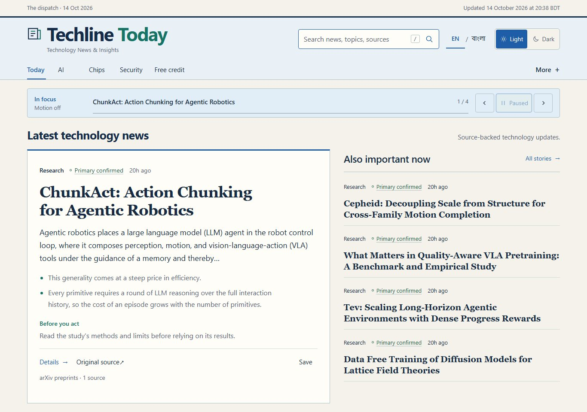
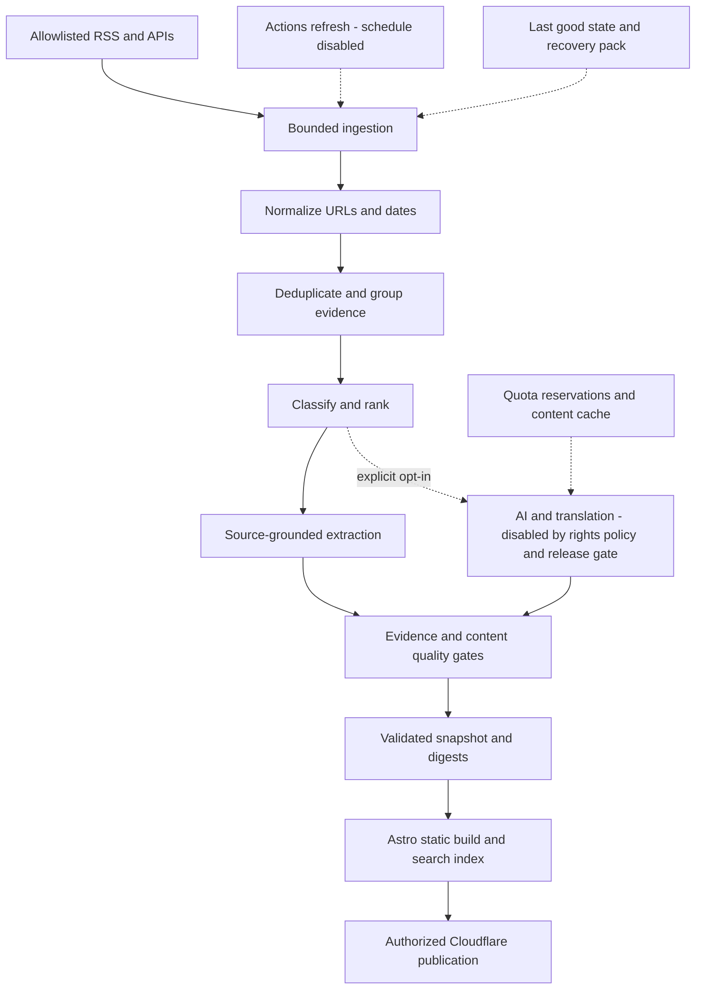

# Techline Today

**A technology briefing with the evidence within reach.**

Techline Today turns RSS and API updates into a readable edition: what changed, what the source actually supports, and where to read more. It combines an Astro reader with a Python pipeline for normalization, deduplication, classification and conservative summaries.

Built independently by **Nafis Afzal**. Original software is **MIT licensed**. The source is public in this repository; Cloudflare preview and production await separate release gates. [Release verification](docs/GITHUB_GATE_A_RELEASE.md).



[Dark theme](docs/assets/launch/home-dark-1366.jpg) · [Mobile](docs/assets/launch/home-light-390.jpg) · [Search and source evidence](docs/assets/launch/README.md)

## Why build this?

Technology announcements arrive across research feeds, vendor blogs and release notes, with uneven detail and repeated coverage. Readers need a short path from a headline to its evidence. This project makes those boundaries visible: source classes, original links, limited excerpts, verification dates, uncertainty and correction history stay attached to a story.

Ranking is an editorial ordering, not a truth score. A headline-only record says so. Unassessed significance is omitted from previews; source provenance does not imply independent corroboration or peer review. The implementation does not claim independent experiments, complete source coverage or real-time reporting.

## The reader

- A ranked briefing, topic directory, category feeds, story details and calendar digests.
- Static Pagefind search with a JSON fallback; bookmarks and reading preferences saved on the reader's device.
- Light/dark themes, responsive navigation and a keyboard-accessible ticker with pause and reduced-motion controls.
- English and Bangla interfaces, with explicit English fallback when a story has no Bangla translation.
- Source-backed model/credit trackers that preserve unknown terms instead of filling gaps.


These are actual browser captures of the local product. They are not usage statistics, physical-phone tests or evidence of a deployed service.

## From a feed item to an edition



Python fetches bounded HTTPS responses from configured hosts. Canonical URLs and stable IDs support deduplication; source classes, dates and evidence remain explicit. Pydantic/JSON Schema and citation/numeric checks reject invalid candidates before replacement. Article pages retain source links, attribution, license information and update history. [Engineering overview](docs/ENGINEERING_OVERVIEW.md).

The default release collection is intentionally narrow: **arXiv descriptive metadata under CC0** and **attributed Cloudflare documentation under CC BY 4.0**. Other adapters remain available in the source, but feeds with unresolved reuse terms are disabled. Their retained records and old screenshots are excluded from the public candidate. News and third-party material are outside the project's MIT grant. [Content policy](docs/CONTENT_RIGHTS_REVIEW.md).

The portal keeps news/official announcements separate from research and reference material. The current permitted edition has no current-news coverage. Publication freshness uses validated dates; collection alone never makes a retained paper new. [Wave 1 contract and review](docs/POST_AUDIT_WAVE1_REMEDIATION.md).

## AI and Bangla: precise scope

The complete baseline works without an inference key or payment. It uses source-derived extraction, not original investigative reporting. Provider adapters and cached translation validation exist, but **production AI is disabled** until provider terms, free-account entitlement, input rights, quotas and durable accounting are approved. There are no visitor-triggered AI calls or silent paid fallbacks. [Provider assessment](docs/FREE_AI_PROVIDER_REVIEW.md).

The Bangla interface is implemented. **Production Bangla story translation is not complete.** Missing translations show a visible notice and retain English evidence. Five authored Bangla fixtures exercise contracts and rendering; they do not establish natural-language quality for real news. Native editorial review remains a separate milestone. [Localization contract](docs/LOCALIZATION.md).

## Run locally

Editorial authority is implemented as an initially **UNPROVISIONED** offline
Ed25519 reviewer system. Separate role/scope grants, exact content signatures and
independently trusted checkpoints feed the existing publication gate. No real
editors or publisher rights are provisioned. Run `uv run python -m pipeline.authority status`
or the ephemeral `demo`; neither activates publication. See the
[security design](docs/PHASE8_EDITORIAL_AUTHORITY.md) and
[owner runbook](docs/PHASE8_OWNER_RUNBOOK.md).

Use Node 24, pnpm **10.33.1**, Python **3.13** and uv **0.12.22**. From the project root:

```sh
pnpm install --frozen-lockfile
uv sync --frozen
uv run python -m pipeline --mode fixture
pnpm dev
```

Open `http://127.0.0.1:4321`. The fixture edition is synthetic and visibly labelled. For permitted live sources, run `uv run python -m pipeline --mode live`, then restart development or rebuild. No AI credentials are required. On this owner's Windows installation, `py -3.12 -m uv` supplies uv, and `pnpm.cmd` avoids PowerShell wrapper restrictions. [Windows setup](docs/LOCAL_SETUP_WINDOWS.md).

```sh
pnpm build
pnpm preview
```

Builds generate static HTML/data, RSS, sitemaps, security headers and search assets in `apps/web/dist`. Default local output is noindex. Export `SITE_NOINDEX=true` for previews with a real origin. Exact production `SITE_URL` and indexing are configured only at the launch gate.

## Develop and verify

```sh
uv run ruff check pipeline
uv run pytest
pnpm lint
pnpm typecheck
pnpm test
uv run python -m pipeline --mode fixture
pnpm build
pnpm exec playwright install chromium firefox webkit
pnpm test:e2e
pnpm verify:site
pnpm security
pnpm audit:dependencies
pnpm verify:docs
pnpm verify:repository
pnpm performance
pnpm deploy:check
```

Restore/recollect live content and rebuild after fixture tests. `pnpm verify:content-rights` checks a live candidate, including referenced archives and built JSON. Hosted smoke accepts a supplied `SMOKE_BASE_URL`; it never assumes a live URL. [Current exact results](docs/OWNER_LAUNCH_VERIFICATION.md) · [Test guide](docs/TESTING.md).

## Deployment and updates

The target is **Cloudflare Workers Static Assets**, with Python/build work on standard GitHub-hosted runners. Cloudflare does not run the ingestion pipeline. No SSR, database, custom domain or paid AI is required.

PR/main CI validates fixtures without publication secrets. Separate manual workflows prepare a noindex preview and production. A semantic fingerprint skips unchanged refreshes; failures preserve the last published edition. Approximately four refresh attempts per day are proposed, with **no schedule enabled**. Free public runner minutes do not remove artifact-storage limits. [Operations](docs/OPERATIONS.md) · [Three release gates](docs/OWNER_GITHUB_LAUNCH_PLAN.md).

## Code map

| Path | Responsibility |
|---|---|
| `apps/web` | Astro pages, React reader islands, styles and UI translations |
| `pipeline` | Source adapters, evidence processing, summaries, translation and recovery |
| `config`, `prompts` | Source/reuse policy, editorial rules, provider limits and release approval |
| `packages`, `schemas` | Shared TypeScript/Python publication contracts |
| `tests`, `scripts` | Browser/unit tests, security, budgets and release tooling |
| `.github` | CI, guarded manual delivery and contribution templates |

Astro 7, React 19, TypeScript, Tailwind CSS, Pagefind, Python, Pydantic and httpx form the core. Frozen pnpm/uv locks make installs reproducible; checked software notices accompany the client bundle.

## Security, limits and next work

Reader preferences stay in browser storage. Analytics is off. Fetching uses public-DNS checks/pinning and response limits; source text is escaped and treated as untrusted input. Strict CSP and response headers ship with static assets. [Security policy](.github/SECURITY.md).

Current limits include narrow rights-approved coverage, imperfect clustering/classification, no production Bangla corpus, no physical-device proof, and unfinished Cloudflare preview/rollback verification. The source/data backup has been restored from an independently stored Google Drive download; clean-machine account recovery remains untested. The build-only cache-policy mitigation requires reassessment by **2026-11-03**. These are tracked engineering limits, not hidden behind clean dependency-audit output.

Next priorities are hosted preview/rollback checks, recurring independent recovery drills, source-by-source coverage expansion and native-reviewed Bangla experiments. AI enrichment is optional and must earn its place through evidence quality, measurable benefit and zero-paid-spend controls.

## License and contributions

[MIT](LICENSE) applies to original software and authored documentation/fixtures. [NOTICE.md](NOTICE.md) explains publisher, brand and third-party exclusions; [software notices](apps/web/public/third-party-notices.txt) remain intact. The working name has preliminary collision risks and is not trademark-cleared.

Small, well-explained contributions are welcome after publication. Start with [CONTRIBUTING.md](CONTRIBUTING.md), include validation and source implications, and preserve the approved visual system. No fake metrics, contributor counts or deployment badges are used.
