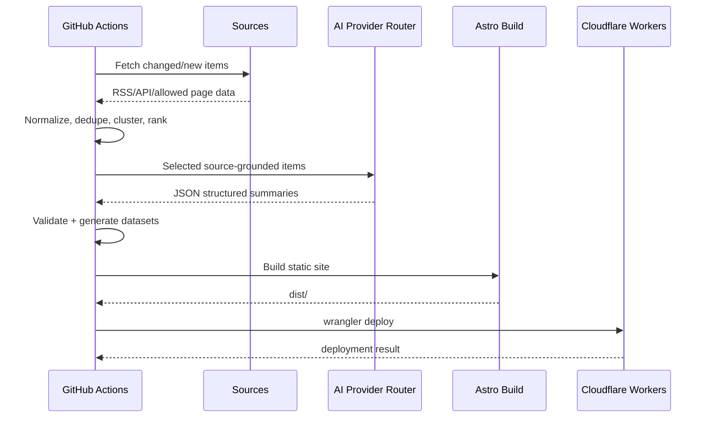

# System Architecture

## Architecture principle

Prefer precomputation over request-time work.


## Repository layout

```text
ai-tech-intelligence/
├─ apps/
│  └─ web/                     # Astro application
├─ pipeline/
│  ├─ adapters/                # RSS/API/site adapters
│  ├─ extractors/
│  ├─ dedupe/
│  ├─ ranking/
│  ├─ ai/
│  ├─ verification/
│  ├─ digests/
│  └─ tests/
├─ packages/
│  ├─ contracts/               # shared schemas/types
│  └─ ui/                      # optional shared components
├─ config/
│  ├─ sources.yaml
│  ├─ categories.yaml
│  └─ ranking.yaml
├─ content/
│  ├─ generated/
│  └─ archives/
├─ scripts/
├─ .github/workflows/
├─ docs/
├─ wrangler.jsonc
└─ README.md
```

## Frontend

Use Astro as the primary page framework because most content is read-heavy and can be pre-rendered. Use React only for interactive islands such as:
- command palette/search;
- bookmark/read-state controls;
- personalized category ordering;
- expandable comparison cards;
- filters;
- keyboard navigation.

Use Tailwind CSS with a small internal design system. Avoid adding a heavy UI library for every element. A few accessible primitives are acceptable.

## Static data strategy

Generate a small number of optimized files:

```text
public/data/latest.json
public/data/categories/ai.json
public/data/categories/dev-apis.json
public/data/digests/2026-10-03.json
public/data/digests/2026-W40.json
public/data/digests/2026-10.json
public/data/stories/<slug>.json
```

Avoid one unnecessary asset per tiny UI element because Cloudflare free plans impose a per-version static file count.

Archive compaction:
- retain individual story pages for 12 to 18 months;
- older stories become monthly/yearly archive bundles;
- keep source URLs and evidence metadata in archives;
- if long-term archive demand grows, move archives to R2/D1 in V2.

## Build/deploy flow



## Upgrade path

Introduce dynamic services behind interfaces:

```text
BookmarkRepository
PreferenceRepository
AlertRepository
FeedRepository
AnalyticsRepository
AIProvider
SourceAdapter
```

V1 implementations are local/static. V2 swaps selected interfaces to Worker + D1 without changing page components.

## Performance targets

Mobile first:
- Lighthouse performance target >= 95 on a realistic production build;
- LCP <= 2.5 s on mid-tier mobile/4G where practical;
- CLS <= 0.1;
- minimal client JavaScript on article/feed pages;
- compressed JSON and no oversized hero media;
- prefetch detail data only on intent/hover where supported;
- use native image lazy loading only for owned/permitted images.

## PWA

Optional V1.1:
- installable web app;
- cache latest digest shell;
- offline access to most recently opened digest;
- never cache source pages or sensitive tokens.
