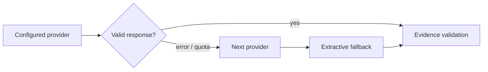
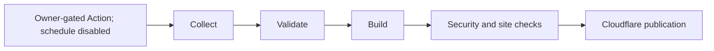

# Engineering overview

The product compresses a technology edition into a lead and a short briefing, then keeps the underlying evidence available. The hard constraints are low recurring cost, source attribution, safe handling of external content, readable mobile layouts and useful operation without an AI key.

## Data and delivery

```mermaid
flowchart LR
    S[RSS / official APIs] --> I[Allowlisted ingestion]
    I --> N[Normalize and verify]
    N --> D[Deduplicate and cluster]
    D --> R[Deterministic ranking]
    R --> A[Summarize]
    A --> V[Contract and evidence validation]
    V --> T[Cached validated translation / English fallback]
    T --> J[Dataset and digests]
    J --> W[Astro static build]
    W --> C[Cloudflare static assets]
```

Python collects a bounded set of records. Canonical URLs, stable IDs, source independence groups and conservative event clustering limit duplicate coverage. Ranking is internal editorial importance, not a public truth score. Headline-only/insufficient-prose records receive a deterministic penalty. The homepage groups prose-backed primary/independent stories first while preserving pipeline order within each group. The frontend consumes that ranking; preferences reorder All stories without changing the editorial lead.

Pydantic validates records and generates JSON Schemas. Numeric facts must map to their evidence, source classes determine evidence labels, and conflicting figures remain attributed. Sources retain publication, collection and verification times. A recheck advances verification only when it succeeds. Missing model terms use null/empty fields, not invented values.

Astro pre-renders HTML, bounded JSON endpoints, RSS, sitemaps and calendar digests. Search is a small React island using Pagefind with a JSON fallback. Saved stories and settings load separate islands; feed interactions use delegated DOM events. Normal reading performs no inference and requires no database. System fonts, natural card heights and progressive feed batches keep the initial page small.

The provisional UI-facing brand is Techline Today. Warm neutral reading surfaces and layered navy themes use 18px reading prose, blue actions and restrained teal identity accents. Category navigation, further stories and source-backed trackers have separate visual roles. In focus uses static ranked headlines with a local, accessible pauseable timer; it adds no network polling. Internal identifiers remain stable. English and `/bn/` routes share templates and structured UI resources. Validated translations are presentation fields over canonical evidence, never independent facts. [Visual decisions](VISUAL_IDENTITY.md), [owner correction](OWNER_DESIGN_CORRECTION.md) and [naming review](BRAND_NAMING_REVIEW.md).

## AI and failure handling

Provider adapters cover Workers AI, Gemini, Groq, OpenRouter and compatible chat endpoints. Retries, timeouts, response sizes, circuit breakers and daily call ceilings are bounded. Calls reserve quota before requests; usage persists separately from successful publication. `PIPELINE_AI_ENABLED=false` is the default; a key/model alone never enables new calls. All keys may remain absent. Extractive action guidance is labelled Before you act. No live inference is validated in this pass.

The cache includes evidence and attribution metadata, prompt contents, output schema, language and summary policy. Provider changes do not silently rewrite unchanged evidence. The extractive path retains citations, limits speculation and explicitly discloses headline-only reports. It cannot add context that the source did not provide.

Translation uses the same reserved provider budgets and failure boundaries during publication. Successful Bangla output is schema/Unicode/numeric/name/uncertainty checked and cached; absent or invalid providers leave that story in English. No browser translation or per-visitor inference occurs. Missing-translation article routes canonicalize to English, remain noindex and stay outside the sitemap. [Localization contract and limits](LOCALIZATION.md); [editorial style](EDITORIAL_STYLE.md).

Individual source failures preserve previously validated records. All-source failure refuses to replace a usable snapshot. Candidate snapshots and archive writes publish only after validation. Fixture and live caches/archives are isolated. Calendar digests use Asia/Dhaka boundaries; older individual records compact into monthly bundles with yearly indexes.

## Security and publication

Only configured HTTPS sources are fetched. Every DNS answer must be public; connections pin an allowed address while preserving TLS hostname checks. Private, link-local, multicast and site-local destinations, unsafe redirects, MIME mismatches and oversized bodies fail closed. HTML requires permission and robots approval. Source text is escaped data in the UI and untrusted evidence in tool-free AI prompts.

Exact-hash CSP and restrictive headers are generated from the build. Keys stay in pipeline or deployment environments. PR CI has no production secrets. Action versions are SHA-pinned; deployment needs the default branch, a production environment and the repository publication switch.

Publication is prepared but disabled and has not been performed. `config/release.json` binds approval to exact repository/visibility/account/Worker/origin/budget/rights/backup and revision; the workflow checks it before collection and deployment. Python runs on the Actions runner; Cloudflare serves only static assets. Off-machine backups remain unprovisioned; the allowlisted checksum export/restore tool supplies local recovery checks. See [release gate](RELEASE_APPROVAL_GATE.md), [deployment](CLOUDFLARE_DEPLOYMENT.md), [costs](SERVICES_AND_COSTS.md) and [operations](OPERATIONS.md). [SECURITY.md](SECURITY.md) records the temporary cache dependency mitigation and its expiry. [TESTING.md](TESTING.md) maps requirements to actual checks.

## Tradeoffs

Updates arrive periodically. Free source coverage is uneven, and some feeds supply only headlines. Deterministic validation catches structural and numeric problems, not every semantic error. Actions cache improves recovery but is evictable; durable operator backups remain necessary. Production Bangla stories need a configured provider and native-reader review; the localized interface and fallback work without one. Accounts, alerts, benchmark dashboards and storage migration are deferred until usage justifies them.

## Current release boundary (2026-10-14)

Only CC0 arXiv descriptive metadata and CC BY Cloudflare documentation are enabled; retained mixed-source summaries/history are pruned. Source submission to inference is denied by default and checked for summary/translation requests. The reader remains English-first with Bangla interface/fallback. MIT covers original code separately from news rights. A semantic edition receipt skips unchanged deployments, including normalized archive verification times; the latest successful collector checkpoint can be newer than the served edition. See the [owner launch plan](OWNER_GITHUB_LAUNCH_PLAN.md) for separate GitHub/preview/production gates and [content policy](CONTENT_RIGHTS_REVIEW.md) for attribution across formats.
