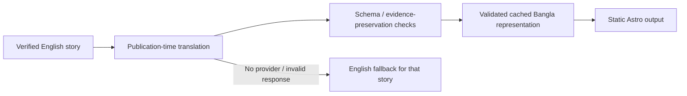

# English and Bangla localization

## Separation and delivery

The live release candidate has **no production Bangla story translations**; its story count is recorded in [current verification](OWNER_LAUNCH_VERIFICATION.md). Five authored translated fixtures validate rendering and contracts; they do not establish production coverage. *Historical capture/evidence retained privately; excluded from public distribution pending source rights review.* and *Historical capture/evidence retained privately; excluded from public distribution pending source rights review.* are clearly marked synthetic. Publication-time provider configuration and native editorial review remain required.

English is canonical. **UI localization and story translation are separate contracts.** UI strings live in `apps/web/src/i18n/en.json` and `bn.json`; shared locale/path/presentation helpers live in `lib/i18n.ts`. Astro generates English routes and `/bn/...` routes from the same templates. Stable category IDs and story slugs are not translated.

The EN / বাংলা selector uses accessible links, no flags. It preserves the current query/hash and stores `ti:v1:language` locally. Normal internal navigation honors that explicit preference. English is the root/default; there is no geography-based redirect. Direct URLs remain authoritative. Links still work when JavaScript or storage is unavailable. Theme, bookmarks and read state are shared across languages; changing language does not erase them.

## Translation stage

`pipeline/translation.py` runs after canonical summarization/verification and tracker curation, before snapshot publication. `prompts/story_translation.md` requests natural Bangla while preserving every claim, array order, name, number, uncertainty and limitation. Translation fields cover headline, three bullets, significance, context, facts, numeric labels/contexts and limitations. Citations, evidence state, number values, dates and source records remain canonical.

Configured compatible providers use the existing AIRouter: Cloudflare, Gemini, Groq, OpenRouter and OpenAI-compatible endpoints. Translation shares reserved provider quotas, retries and circuit breakers with summaries. `config/ai.yaml` defaults to a maximum of 20 translation attempts per run, 3,000 output tokens per request and six-hour failure retry spacing. Provider configuration is required; no credential was present in this validation.

Cache keys include canonical content, evidence hash, fact source IDs/status, prompt contents, translation schema, target language and policy. Successful entries are reused without another inference call. Canonical/evidence changes invalidate them. Failed entries are bounded negative cache records. Fixture/live caches are isolated. Invalid/stale cache records are discarded; one story’s failure does not stop publication. Normal visitors incur **zero translation calls**.

The prepared manual publication workflow restores `.cache/translations-live.json` with provider reservations and saves it even if a later build/deployment fails. No schedule is active. Only validated pipeline output enters that cache; canonical hashes are rechecked on reuse. GitHub Actions cache is evictable and accessible within public-repository cache rules, so it must contain no confidential data and durable operator backups remain necessary.

## Validation and fallback

Reject empty/missing Bangla headlines, accidental identical English output, broken Unicode/control characters, unexpected HTML, excessive length, changed array lengths, duplicate bullets, changed numeric tokens/units/currency and removed known model/product names. Detectable uncertainty/negation must remain in its corresponding field. Both numeric count and value are checked, including normalized Bangla digits.

Automated coverage is conservative and incomplete: regex name/uncertainty detection can reject legitimate paraphrases and miss subtle meaning changes; it is not semantic certification. Native-reader/editor review is needed before presenting a production Bangla corpus as fully reviewed.

With no capable provider or a rejected response, the story remains English. Bangla pages explicitly say **“এই খবরের বাংলা অনুবাদ নেই। ইংরেজি দেখানো হচ্ছে।”** and mark canonical text with its English language tag. No dictionary substitution or fabricated machine translation is shipped. Offer/model tracker details, source evidence, correction history, archive records and generated edition notes retain their verified English wording with explanatory labels.

The five authored translations in `pipeline/translation_fixtures.py` cover AI/model, research, chips, security and free-credit/API stories. They are **synthetic test examples**, never a deterministic translator for real stories. `fixture-reviewed` representations are rejected in live snapshots. They allow offline quality/rendering tests with no external AI dependency. Live validation had zero available Bangla story translations: production content requires the configured stage and subsequent human review.

## URLs, SEO and search

- English lives at `/...`; Bangla at `/bn/...`. Corresponding pages use self-canonical URLs and reciprocal `en`, `bn`, `x-default` links when the story has a validated translation.
- A Bangla story URL without a translation remains usable, but is **noindex, follow**, canonicalizes to its English story, omits language alternates and is excluded from the sitemap. It becomes self-canonical/indexable on a later valid translation/build.
- Localized listing/about/digest pages use their own canonical/alternates. Shared English records inside a localized listing are explicitly language-tagged; no claim of translated tracker/archive bodies is made.
- Saved/settings and both 404 pages remain private/noindex and outside the sitemap. Fixture/example-origin builds remain noindex/nofollow and robots-disallowed as before.
- RSS remains one canonical **English** feed, labelled English. No duplicate pseudo-Bangla feed is generated.
- [Pagefind selects an index from the page’s HTML language](https://pagefind.app/docs/multilingual/). Its current Bangla index has no stemming; matching still works. `/data/search-bn.json` provides localized/fallback search records with safe `/bn/story/...` links. Indexed/fallback previews now use clean summary metadata, carry the actual story language, and exclude reader-action labels. The existing 120ms debounce is retained; stale requests cannot replace newer results, and no-results feedback is localized.
- Build packaging emits `/bn/404.html`; the hardened local preview returns it with status 404 for missing `/bn/...` paths. This follows [Cloudflare’s nearest-404 convention](https://developers.cloudflare.com/workers/static-assets/routing/static-site-generation/). Actual edge behavior still requires authorized deployment verification.

## Fonts and future languages

No webfont download is added. Bangla falls back through Nirmala UI, Vrinda, Noto Sans Bengali, Hind Siliguri, Lohit Bengali and sans-serif, with increased line height. Actual Windows Chromium checks cover shaping, mixed English/Bangla names, punctuation, numbers, wrapping and both themes at all six requested widths. Android/Linux fallback availability is architectural support, not a completed physical-device test.

To add a language: add a mirrored UI resource; extend Locale/routes; add a translation contract/schema target and validators; configure capable providers/budget; extend presentation, search, SEO and sitemap rules; add offline examples and browser/native-language review. Keep canonical evidence immutable and failure isolated. Do not expand the language selector before the content and checks are ready.

See [EDITORIAL_STYLE.md](EDITORIAL_STYLE.md), [TESTING.md](TESTING.md) and [IMPLEMENTATION_VALIDATION.md](IMPLEMENTATION_VALIDATION.md).

## Release verification, 2026-10-14

The production corpus has no available Bangla story translations. AI/translation calls require explicit `PIPELINE_AI_ENABLED=true`, configured providers and separate owner budget approval. The safe proposed launch is English reporting with a Bangla interface and truthful English fallback. Three-engine responsive/device simulation includes both scripts, themes and native-field sizing; physical phones and native-reader review remain unverified. [Current evidence](RELEASE_VALIDATION.md).
